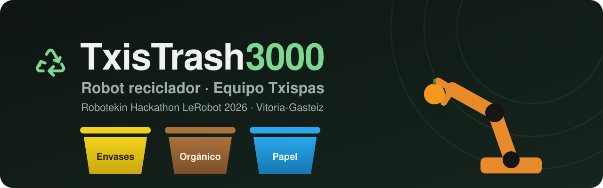
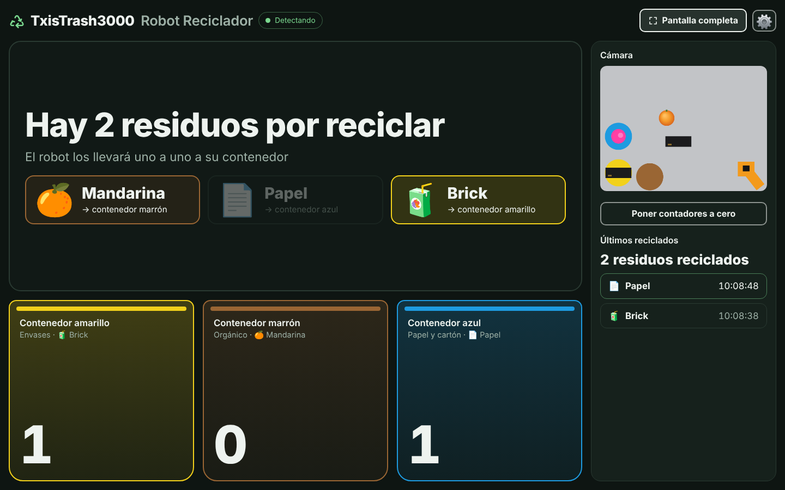
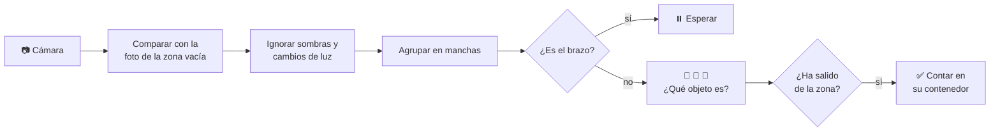

<p align="center">
  
</p>

<p align="center">
  
  
  
  
</p>

<p align="center">
  <b>Un brazo robótico que separa los residuos en su contenedor, y una pantalla que cuenta todo lo que recicla.</b>
</p>

---

## ♻️ Qué hace

Dejas residuos en la mesa y el robot **SO-101** los lleva a su contenedor, con los mismos colores que los de la calle:

| | Residuo | Contenedor |
|:-:|---|---|
| 🍊 | Mandarina | 🟫 **Marrón** · orgánico |
| 📄 | Papel | 🟦 **Azul** · papel y cartón |
| 🧃 | Brick | 🟨 **Amarillo** · envases |

Mientras tanto, esta interfaz mira la mesa con una cámara, **reconoce qué residuos hay** en la zona de recogida (aunque haya varios a la vez) y **cuenta cada uno cuando el robot se lo lleva**.

<p align="center">
  
  <br><sub>Modo contador. La imagen de la cámara de esta captura es una simulación.</sub>
</p>

## 🚀 Pruébalo

<p align="center">
  <a href="https://electronicosbilbao.github.io/txistrash3000/"></a>
</p>

Es **un único archivo**, [`index.html`](index.html). No hay que instalar nada.

- **En el ordenador:** descarga `index.html` y ábrelo con doble clic en **Google Chrome** o **Microsoft Edge**.
- **En el móvil o el iPad:** abre [electronicosbilbao.github.io/txistrash3000](https://electronicosbilbao.github.io/txistrash3000/) en Safari. Solo deja usar la cámara en páginas https, y esta lo es.

## 🎓 Cómo se usa

1. **Activa la cámara** con el botón *Activar cámara*.
2. **Dibuja la zona de recogida** a mano alzada: mantén pulsado sobre la imagen y rodea la zona donde se dejan los objetos. Al soltar, se cierra sola. Deja fuera la posición de reposo del brazo y los contenedores.
3. **Enséñale a la cámara** con los botones:

   | Botón | Qué hacer |
   |---|---|
   | ⬜ Zona vacía | Mesa sin objetos, brazo en reposo y nadie en la imagen |
   | 🍊 🧃 📄 Objetos | Cada uno **solo** en la zona, sin tocar el borde, 2 o 3 veces en sitios distintos |
   | 🦾 Brazo | El brazo quieto dentro de la zona, en 2 o 3 posturas |

4. Pulsa **Terminar de enseñar →** para pasar al modo contador.
5. Antes de empezar: **Poner contadores a cero** y **Pantalla completa**.

El engranaje ⚙️ vuelve al modo de enseñar. Lo aprendido y los contadores se guardan en el navegador, así que se conservan aunque recargues la página.

## 🧠 Cómo funciona



- **Foto de referencia.** Se guarda una imagen de la mesa vacía y cada fotograma se compara con ella.
- **Sombras y luz.** Un píxel que solo se ha vuelto más oscuro o más claro, sin cambiar de color, se ignora. Así no cuentan ni las sombras ni los ajustes automáticos de brillo de la cámara.
- **Objetos.** Cada mancha se compara con los colores aprendidos de cada objeto, con tolerancia a pequeños cambios de tono.
- **Brazo.** Una mancha es el brazo si tiene su naranja y además entra por el borde de la zona o es mucho más grande que cualquier objeto. Mientras el brazo está en la zona o algo se mueve, no se decide nada.
- **Conteo.** Un objeto cuenta como reciclado cuando **sale** de la zona y se queda fuera con la imagen quieta.

## 💡 Consejos

- Vuelve a enseñar la **zona vacía** si cambia la luz o se mueve la cámara.
- Separa un poco los objetos y déjalos lejos del borde de la zona.
- Si la cámara también la usa SenseCraft, en Windows 11 se puede permitir que varias aplicaciones la usen a la vez: *Configuración → Bluetooth y dispositivos → Cámaras → Configuración avanzada de la cámara*.
- Para verlo en un iPad como segunda pantalla de un portátil con Windows sirve [spacedesk](https://www.spacedesk.net).

## 🌐 Publicarlo con GitHub Pages

En el repositorio: **Settings → Pages → Branch: `main` / `(root)` → Save**. En un par de minutos la interfaz queda publicada en [electronicosbilbao.github.io/txistrash3000](https://electronicosbilbao.github.io/txistrash3000/).

## 📁 Contenido

```
├── index.html        La interfaz completa (HTML, CSS y JavaScript en un solo archivo)
├── README.md
└── assets/
    ├── portada.svg   Imagen de portada
    └── captura.png   Captura de la interfaz
```

## 👥 Equipo

**Txispas** · [Robotekin Hackathon LeRobot 2026](https://hackathon.robotekin.com) · Vitoria-Gasteiz, 23–25 de octubre de 2026
